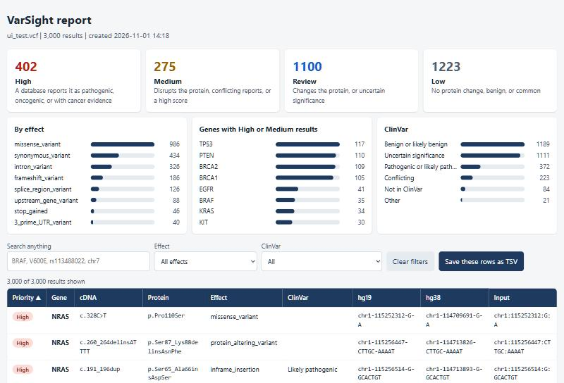
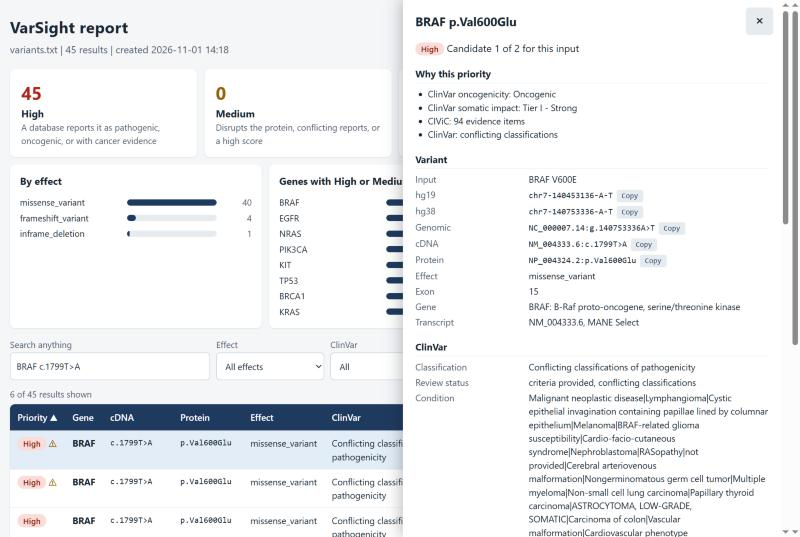
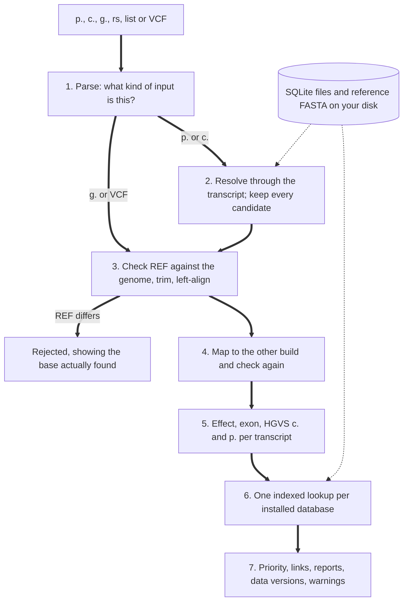

# VarSight

[](https://github.com/prabirsh/VarSight/actions/workflows/ci.yml)
[](https://github.com/prabirsh/VarSight/actions/workflows/codeql.yml)
[](LICENSE)

**Offline variant annotation for hg19 and hg38, on Ubuntu, WSL, PowerShell and Command Prompt.** Give it a protein change, a cDNA change, a genomic position or a whole VCF. It returns the variant on both builds, HGVS names, its effect, what each database says, a review priority with its reasons, and a link to check each database yourself.



> [!IMPORTANT]
> VarSight is research software. Results for patient care must be checked against the linked sources and validated by your laboratory. See [how far it has been tested](#how-far-it-has-been-tested).

## The problem, and how this helps

| What people face | Why | What you get |
| - | - | - |
| One variant, many websites | Each database has its own search and naming | One result with a labelled link per database |
| The same variant, different names | Three major tools agreed on the c. name for only 58.52% of 164,549 ClinVar variants ([Human Genomics 2025](https://pmc.ncbi.nlm.nih.gov/articles/PMC12181866/)) | Names measured against ClinVar's, ClinVar's own names alongside, and every candidate for a p. name |
| Patient data leaving the building | A web search sends the variant to that site | Annotation has no network code, and a test enforces it |
| hg19 and hg38 mixed up | A wrong-build VCF can look fine | The build is read from the VCF itself, a contradiction stops the run, and both positions are shown |
| Thousands of rows and no starting point | A VCF doesn't say what to read first | Results sorted by priority, each with its reason. It sorts only, and is not a classification |
| Stale data nobody notices | Local databases age quietly | A notice when a newer version exists, which never slows the run |
| Hard installs | Common tools need a runtime and a large cache | Only Python: no pip packages, no administrator rights, no API keys |

[The research behind this, with sources and a comparison of other tools](docs/research.md).

## Quick start

**Ubuntu or WSL:**

```bash
git clone https://github.com/prabirsh/VarSight.git
cd VarSight
sh install.sh
```

**Windows PowerShell** (or `install.bat` in Command Prompt), with Python from python.org:

```powershell
powershell -ExecutionPolicy Bypass -File .\install.ps1
```

This installs the `varsight` command and runs the [demo](demo/README.md) with no download. Then choose your databases. Setup asks whether you want hg19, hg38 or both, and downloads only that:

```bash
varsight setup
```

```bash
varsight annotate "BRAF V600E" build=hg19
varsight annotate sample.vcf.gz
```

**[The full guide for each system](docs/run-guide.md)** covers every step and common problems.

## Input

**Always put a variant in quotes,** because of the `>`.

| You have | Example | Build needed? |
| - | - | - |
| Protein change | `BRAF V600E`, `NP_004324.2:p.Val600Glu`, `EGFR E746_A750del` | Optional |
| cDNA change | `NM_004333.6:c.1799T>A`, `BRAF c.1799T>A` | Optional |
| Genomic HGVS | `NC_000007.13:g.140453136A>T`, `chr7:g.140453136A>T` | Not with a RefSeq accession; otherwise `build=` |
| Position | `chr7-140453136-A-T` | `build=` |
| dbSNP number | `rs113488022` | Optional |
| A list | A text file with one of the above per line | As above |
| A VCF | `.vcf`, `.vcf.gz` or `.vcf.bgz` | Read from the header |

VarSight works with hg19 and hg38. hg18 is refused rather than guessed at.

## Output

A single variant prints a card on the screen. A list or VCF gets a folder, `sample_varsight/`, with three reports:

| File | For |
| - | - |
| `report.html` | Exploring. One file that opens with a double click, works offline and can be emailed: search, filters, sorting, and a details panel for each result |
| `results.xlsx` | Sharing. Sheets: Summary, Priority, All results, Warnings explained, Data versions |
| `results.tsv` | Your own scripts |





Each result links to ClinVar, NCBI Gene, NCBI RefSeq, dbSNP, HGNC, Ensembl, UniProt, Pfam, ProteinPaint, Franklin, COSMIC, VarSome and OncoKB, plus gnomAD, UCSC Genome Browser, ClinGen, CIViC, OMIM, cBioPortal and PubMed. Each link is labelled **confirmed ID** (from local data) or **built** (made from the variant, so the page may hold nothing). COSMIC, OncoKB, Franklin, VarSome and ProteinPaint are links only. [Every column and warning](docs/input-output.md).

## How it works



Each large download is converted once at setup into a SQLite file with an index, so annotating never scans a file or uses the network. To see every step, file and query for one variant:

```bash
varsight explain "BRAF V600E" build=hg19
```

[How lookups work, step by step](docs/how-lookups-work.md).

## Databases

**Core, installed by setup:** UCSC reference, RefSeq, GENCODE, MANE, ClinVar, HGNC, UniProt, Pfam, CIViC, ClinGen gene curation, gnomAD gene constraint, HPO, and Ensembl chain files.

**Advanced, your choice.** A report gains columns only for what you add:

| Add it like this | Databases |
| - | - |
| `varsight add NAME` | `dbsnp` (brings TOPMed frequencies), `gnomad`, `thousand_genomes`, `gnomad_sv`, `phylop`, `hotspots`, `decipher`, `clingen_variants` |
| `varsight add NAME accept` | `revel`, `alphamissense` |
| `varsight add NAME file=PATH accept`, with your own licensed download | `cosmic`, `cosmic_census`, `cosmic_fusions`, `omim`, `spliceai`, `primateai` |

`varsight databases` lists each with its size and licence. [Sizes, licences and what has been tested](docs/data-sources.md). **Check the licences against your use**, particularly if results go into paid reports.

## Keeping data current

A notice appears by itself when something newer exists. Reading it is one small file, and the check runs apart from annotation, sending nothing about your variants.

```bash
varsight update check
varsight update
varsight rollback
```

New data is built beside the current data, tested with known variants, and only then switched in. Transcript updates can change names, so they wait for your approval. [Details, and how to schedule it](docs/updates.md).

## Benchmarks and requirements

Measured on a laptop with a 2-core i3 and 3.9 GB of memory, using gene-dense public records on the demo data. [Full tables, and published figures for other tools](docs/benchmarks.md).

| Task | Result |
| - | -: |
| One variant | About 2 ms |
| 3,000 records to TSV | About 12 s |
| 30,000 records to TSV, 1 process | 156 s on WSL, 113 s on Windows |
| 30,000 records to TSV, 4 processes | 83 s on WSL, 60 s on Windows |
| 30,000 records to all three reports, the default | 170 s on WSL, 127 s on Windows |
| Peak memory | Under 150 MB for one report on 3,000 records; about 500 MB for all three on 30,000 |

| You choose | Download | Kept on disk (estimate) |
| - | - | -: |
| hg19 or hg38 | About 2.4 GB, plus 4.7 GB of Pfam read without saving | About 5 GB |
| Both | 3.3 GB, plus 4.7 GB of Pfam read without saving | About 10 GB |

You need Python 3.10 or newer on Linux, WSL, or Windows 10 and later, with about 2 GB of free memory.

## How far it has been tested

Real public data for 12 genes, using 13,724 ClinVar names per build. [Full results and every mismatch group](docs/validation.md).

| Test on hg19 | Passed | Rate |
| - | -: | -: |
| Genome position to c. name, SNVs | 9,085 of 9,087 | 99.98% |
| Genome position to c. name, indels | 4,022 of 4,029 | 99.83% |
| Genome position to p. name, SNVs | 6,945 of 6,946 | 99.99% |
| Genome position to p. name, indels | 3,617 of 3,637 | 99.45% |
| hg19 to hg38 mapping | 13,723 of 13,723 | 100% |

**Not yet proven:**

- **The whole genome.** These rates cover 12 well-studied genes. Run `varsight validate` after setup to measure your own data.
- **The full setup.** The whole cycle passes against a local test server, but the full download has not been run end to end, so its time and disk figures are estimates.
- **Licensed databases.** The COSMIC, OMIM, SpliceAI and PrimateAI readers follow each provider's documented columns, without a real file. A mismatch stops with a clear message.
- **Microsoft Excel itself.** Workbooks were checked with a separate reader, not opened in Excel.
- **Other Python versions.** Run on Python 3.14 so far. CI covers 3.10 to 3.14 on Linux, and 3.10 and 3.14 on Windows.

Not covered: CNVs and structural variant calling, and effects on mitochondrial transcripts.

## Commands

| Command | What it does |
| - | - |
| `varsight annotate INPUT` | Annotate a description, a list file or a VCF |
| `varsight setup` | Choose builds, then download and build the data |
| `varsight databases` | List every database, its size and licence |
| `varsight add NAME`, `varsight remove NAME` | Add or remove an advanced database |
| `varsight update`, `varsight rollback` | Apply new versions, or go back |
| `varsight status`, `varsight doctor` | What is installed, and a check of this computer |
| `varsight explain INPUT` | Show each step, file and query |
| `varsight selftest`, `varsight validate`, `varsight benchmark` | Known variants, accuracy, and speed |
| `varsight demo`, `varsight config`, `varsight help` | Demo with no download, settings, and help |

## Security and privacy

No runtime dependencies, no telemetry, HTTPS with a host allow-list, read-only databases, parameterised SQL, protection against formula and script injection in reports, and private output files on Linux. Tests read the source and fail if network code appears outside the download module. [Details and your own responsibilities](SECURITY.md).

## Documentation

- [Run guide: Ubuntu, WSL, PowerShell, Command Prompt](docs/run-guide.md)
- [How lookups work](docs/how-lookups-work.md)
- [Input and output reference](docs/input-output.md)
- [Data sources, licences and links](docs/data-sources.md)
- [Updates](docs/updates.md)
- [Benchmarks and requirements](docs/benchmarks.md)
- [Validation](docs/validation.md)
- [Research and other tools](docs/research.md)
- [Architecture](docs/architecture.md)
- [Security](SECURITY.md) and [Contributing](CONTRIBUTING.md)

## Citing and licence

Code: [MIT](LICENSE). The data belongs to its sources and keeps its own terms. If you publish results, cite VarSight ([CITATION.cff](CITATION.cff)) and the data sources you relied on.
