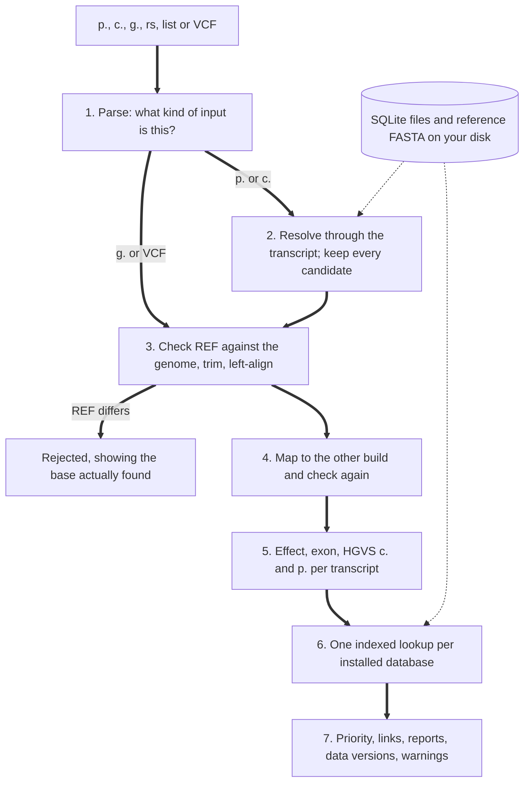

# VarShift

[](https://github.com/prabirsh/VarShift/actions/workflows/ci.yml)
[](https://github.com/prabirsh/VarShift/actions/workflows/codeql.yml)
[](LICENSE)

**Offline variant annotation for hg19 and hg38, on Ubuntu, WSL, PowerShell and Command Prompt.** Give it a protein change, a cDNA change, a genomic position or a whole VCF. It returns the variant on both builds, HGVS names, its effect, what each database says, a review priority with its reasons, and a link to check each database yourself.



> [!IMPORTANT]
> VarShift is research software. Results for patient care must be checked against the linked sources and validated by your laboratory. See [how far it has been tested](#how-far-it-has-been-tested).

## The problem, and how this helps

| What people face | Why | What you get |
| - | - | - |
| One variant, many websites | Each database has its own search and naming | One result with a labelled link per database |
| The same variant, different names | Three major tools agreed on the c. name for only 58.52% of 164,549 ClinVar variants ([Human Genomics 2025](https://pmc.ncbi.nlm.nih.gov/articles/PMC12181866/)) | Names measured against ClinVar's, ClinVar's own names alongside, and every candidate for a p. name |
| One protein change, several DNA changes | `BRAF V600E` can come from two DNA changes. Tools list them with equal weight, or pick one without saying which or why | One answer, and why it was chosen: in ClinVar when the others aren't, or the fewest bases changed. The others are named on one line. When nothing decides between them, you choose |
| A typing slip ends the run | `braf val600glu` or `BRAF c.1799T-A` stops most tools with an error | Slips with one sensible reading are read correctly, and the answer says how. A guess becomes a numbered question, or `Did you mean:` in a script |
| Patient data leaving the building | A web search sends the variant to that site | Annotation has no network code, and a test enforces it |
| hg19 and hg38 mixed up | A wrong-build VCF can look fine | The build is read from the VCF itself, a contradiction stops the run, and both positions are shown |
| Thousands of rows and no starting point | A VCF doesn't say what to read first | Results sorted by priority, each with its reason. It sorts only, and is not a classification |
| Stale data nobody notices | Local databases age quietly | A notice when a newer version exists, which never slows the run |
| Hard installs | Common tools need a runtime and a large cache | Only Python: no pip packages, no administrator rights, no API keys |

[The research behind this, with sources and a comparison of other tools](docs/research.md).

## Quick start

**Ubuntu or WSL:**

```bash
git clone https://github.com/prabirsh/VarShift.git
cd VarShift
sh install.sh
```

**Windows PowerShell** (or `install.bat` in Command Prompt), with Python from python.org or `winget install Python.Python.3.12`:

```powershell
powershell -ExecutionPolicy Bypass -File .\install.ps1
```

This installs the `varshift` command and runs the [demo](demo/README.md) with no download. To choose where the command goes, or to skip the demo or setup, see [installer options](docs/run-guide.md#installer-options). Then choose your databases. Setup asks whether you want hg19, hg38 or both, and downloads only that:

```bash
varshift setup
```

Then type `varshift` on its own. It opens the guided start: type variants the way a colleague wrote them, one or several, see each answer, and `save` them to Excel with every link. Here it is on the full hg19 data:

```text
> braf v600e; KRAS G12D; BRFA V600E
BRFA isn't a gene symbol. Did you mean:
  1  BRAF  ClinVar: 1,647 records
  2  BRF1  ClinVar: 273 records
  ...
Choose 1 to 4, or Enter to cancel: 1
  1  braf v600e  chr7-140453136-A-T      HIGH  ClinVar Conflicting · CIViC 94 items
  2  KRAS G12D   chr12-25398284-C-T      HIGH  ClinVar Pathogenic/Likely pathogenic · CIViC 21 items
  3  BRFA V600E  chr7-140453136-A-T      HIGH  ClinVar Conflicting · CIViC 94 items
Type a number to see its full answer. 3 results in this session; save writes them to Excel.
> save
Saved 3 results to varshift-session-2026-11-09-1813.xlsx
```

Or one command at a time, as in a script. `varshift examples` shows every way to write a variant:

```bash
varshift annotate "BRAF V600E" build=hg19
varshift annotate "BRAF V600E; KRAS G12D; TP53 R175H" build=hg19 out=results.xlsx
varshift annotate sample.vcf.gz
varshift examples
```

**In WSL with the data on a Windows drive** (`/mnt/c`, `/mnt/p` and so on), run `setup`, `update` and `add` from PowerShell, and annotate from either. WSL refuses to build on a Windows drive, because it is about 30 times slower and can run out of memory. [How to share one data folder](docs/run-guide.md#2-set-up-the-databases).

**[The full guide for each system](docs/run-guide.md)** covers every step and common problems.

## Input

**Always put a variant in quotes,** because of the `>`.

| You have | Example | Build needed? |
| - | - | - |
| Protein change | `BRAF V600E`, `NP_004324.2:p.Val600Glu`, `EGFR E746_A750del` | Optional |
| cDNA change | `NM_004333.6:c.1799T>A`, `BRAF c.1799T>A` | Optional |
| Genomic HGVS | `NC_000007.13:g.140453136A>T`, `chr7:g.140453136A>T` | Not with a RefSeq accession; otherwise `build=` |
| Position | `chr7-140453136-A-T` | `build=` |
| dbSNP number | `rs113488022` | Optional |
| Several at once | `BRAF V600E; KRAS G12D; TP53 R175H` | As above |
| A list | A text file with one of the above per line | As above |
| A VCF | `.vcf`, `.vcf.gz` or `.vcf.bgz` | Read from the header |

VarShift works with hg19 and hg38. hg18 is refused rather than guessed at.

**Written a little differently?** Slips with only one sensible reading are fixed, and the answer shows how it read them, as in `Read as BRAF Val600Glu (amino acids written in standard case)`. That covers `braf val600glu`, `BRAF c.1799T-A`, `NM_004333.6:1799T>A`, `chr7:140,453,136 A>T`, a gene alias such as `HER2`, and text pasted from a document. Anything that needs a guess is asked about instead: `BRAF V600` lists the changes ClinVar and CIViC know at that residue, `BRFA V600E` the gene symbols it may be, and a wrong residue or base what the sequence really has. In a script, or with `out=`, you get `Did you mean:` and the run never waits. In a list file, the suggestions go in a `suggestion` column. VCF records are never changed.

## Output

A single variant prints one answer on the screen, short enough to read at a glance:

```text
BRAF V600E  ->  chr7-140453136-A-T (hg19)
  HIGH        ClinVar oncogenicity: Oncogenic · ClinVar somatic impact: Tier I - Strong · CIViC: 94
              evidence items · ClinVar: conflicting classifications
  Gene        BRAF   NM_004333.6 (MANE Select)   exon 15
  Names       c.1799T>A   p.Val600Glu   NC_000007.13:g.140453136A>T
  ...
  Why this    in ClinVar; the others aren't · MANE Select transcript
  Also        1 other DNA change gives p.Val600Glu: c.1799_1800delinsAA (2 bases, not in ClinVar).
              To see it: show=all
  Check it    ClinVar              https://www.ncbi.nlm.nih.gov/clinvar/variation/13961/
              gnomAD               https://gnomad.broadinstitute.org/variant/7-140453136-A-T?dataset=gnomad_r2_1
              ...
              15 more: links=all
```

When nothing decides between candidates, as for an rs number with several alleles, you get a numbered table and choose. `show=all` prints every candidate in full, and `links=all` every link. `mode=tumour` puts CIViC, OncoKB and cBioPortal first, and `mode=inherited` puts ClinGen, gnomAD constraint and OMIM first; `varshift config mode=tumour` keeps it. Warnings are written as sentences, and colour is used only in a terminal.

A list or VCF gets a folder in the current directory, `sample_varshift/`, or wherever `out=` says, with three reports:

| File | For |
| - | - |
| `report.html` | Exploring. One file that opens with a double click, works offline and can be emailed: search, filters, sorting, and a details panel for each result |
| `results.xlsx` | Sharing. Sheets: Summary, Priority, All results, Links, Warnings explained, Data versions. The Links sheet has one clickable row per result and database |
| `results.tsv` | Your own scripts |


Each result links to ClinVar, NCBI Gene, NCBI RefSeq, dbSNP, HGNC, Ensembl, UniProt, Pfam, ProteinPaint, Franklin, COSMIC, VarSome and OncoKB, plus gnomAD, UCSC Genome Browser, ClinGen, CIViC, OMIM, cBioPortal and PubMed. Each link is labelled **confirmed ID** (from local data) or **built** (made from the variant, so the page may hold nothing). COSMIC, OncoKB, Franklin, VarSome and ProteinPaint are links only. [Every column and warning](docs/input-output.md).

## How it works



Each large download is converted once at setup into a SQLite file with an index, so annotating never scans a file or uses the network. To see every step, file and query for one variant:

```bash
varshift explain "BRAF V600E" build=hg19
```

[How lookups work, step by step](docs/how-lookups-work.md).

## Databases

**Core, installed by setup:** UCSC reference, RefSeq, GENCODE, MANE, ClinVar, HGNC, UniProt, Pfam, CIViC, ClinGen gene curation, gnomAD gene constraint, HPO, and Ensembl chain files.

**Advanced, your choice.** A report gains columns only for what you add:

| Add it like this | Databases |
| - | - |
| `varshift add NAME` | `dbsnp` (brings TOPMed frequencies), `gnomad`, `thousand_genomes`, `gnomad_sv`, `phylop`, `hotspots`, `decipher`, `clingen_variants` |
| `varshift add NAME accept` | `revel`, `alphamissense` |
| `varshift add NAME file=PATH accept`, with your own licensed download | `cosmic`, `cosmic_census`, `cosmic_fusions`, `omim`, `spliceai`, `primateai` |

`varshift databases` lists each with its size and licence. [Sizes, licences and what has been tested](docs/data-sources.md). **Check the licences against your use**, particularly if results go into paid reports.

## Keeping data current

A notice appears by itself when something newer exists. Reading it is one small file, and the check runs apart from annotation, sending nothing about your variants.

```bash
varshift update check
varshift update
varshift rollback
```

New data is built beside the current data, tested with known variants, and only then switched in. Transcript updates can change names, so they wait for your approval. [Details, and how to schedule it](docs/updates.md).

## Benchmarks and requirements

Measured on a laptop with a 2-core i3 and 3.9 GB of memory, using gene-dense public records on the demo data. [Full tables, and published figures for other tools](docs/benchmarks.md).

| Task | Result |
| - | -: |
| One variant | About 2 ms |
| 3,000 records to TSV | About 12 s |
| 30,000 records to TSV, 1 process | 156 s on WSL, 113 s on Windows |
| 30,000 records to TSV, 4 processes | 83 s on WSL, 60 s on Windows |
| 30,000 records to all three reports, the default | 170 s on WSL, 127 s on Windows |
| Peak memory | Under 150 MB for one report on 3,000 records; about 500 MB for all three on 30,000 |

| You choose | Download | Kept on disk | Setup time at 2 MB/s |
| - | - | -: | -: |
| hg19 or hg38 | About 1.7 GB for hg19, 1.9 GB for hg38 | About 5 GB | [About 45 minutes](docs/benchmarks.md#setup-time) |
| Both | 3.0 GB | About 10 GB | About 1.5 hours (estimate) |

You need Python 3.10 or newer on Linux, WSL, or Windows 10 and later, with about 2 GB of free memory.

## How far it has been tested

A sample of 20,027 ClinVar names from across the genome, on a complete hg19 setup. [Full results and every mismatch group](docs/validation.md).

| Test on hg19 | Passed | Rate |
| - | -: | -: |
| Genome position to c. name, SNVs | 18,527 of 18,539 | 99.94% |
| Genome position to c. name, indels | 1,396 of 1,413 | 98.80% |
| Genome position to p. name, SNVs | 14,982 of 15,010 | 99.81% |
| Genome position to p. name, indels | 964 of 996 | 96.79% |
| hg19 to hg38 mapping, on 12 genes only | 13,723 of 13,723 | 100% |

Most of the remaining indel differences are the same change written another way, such as `p.Glu43dup` for ClinVar's `p.Glu43_Ser44insGlu`. Transcripts that don't align exactly to the genome, 1,231 on hg19, are numbered through RefSeq's own alignment, so their names match RefSeq's.

**Not yet proven:**

- **hg38 accuracy.** Measured on 12 well-studied genes only. Run `varshift validate` after setup to measure your own data.
- **Every setup path.** hg19 has run from start to the self-test, natively on Windows, followed by a real update and rollback, and WSL has annotated from that same data. hg38, both builds together, and a full build inside WSL haven't.
- **Current Pfam positions.** Domain positions come from Pfam 37.0, the newest release with a small human-only file, so 9.8% of today's protein and family pairs have none. [Details](docs/data-sources.md#core-databases).
- **Licensed databases.** The COSMIC, OMIM, SpliceAI and PrimateAI readers follow each provider's documented columns, without a real file. A mismatch stops with a clear message.
- **Microsoft Excel itself.** Workbooks were checked with a separate reader, not opened in Excel.
- **Other Python versions.** Run on Python 3.12 (Windows) and 3.14 (WSL) so far. CI covers 3.10 to 3.14 on Linux, and 3.10 and 3.14 on Windows.

Not covered: CNVs and structural variant calling, and effects on mitochondrial transcripts.

## Commands

| Command | What it does |
| - | - |
| `varshift`, `varshift start` | The guided start: type variants, see answers, save them |
| `varshift annotate INPUT` | Annotate a description, several separated by `;`, a list file or a VCF |
| `varshift examples` | Every way to write a variant, each with an example that works |
| `varshift setup` | Choose builds, then download and build the data |
| `varshift databases` | List every database, its size and licence |
| `varshift add NAME`, `varshift remove NAME` | Add or remove an advanced database |
| `varshift update`, `varshift rollback` | Apply new versions, or go back |
| `varshift status`, `varshift doctor` | What is installed, and a check of this computer |
| `varshift explain INPUT` | Show each step, file and query |
| `varshift selftest`, `varshift validate`, `varshift benchmark` | Known variants, accuracy, and speed |
| `varshift demo`, `varshift config`, `varshift help` | Demo with no download, settings (data folder, mode, colour, the update check), and help |

## Security and privacy

No runtime dependencies, no telemetry, HTTPS with a host allow-list, read-only databases, parameterised SQL, protection against formula and script injection in reports, and private output files on Linux. Tests read the source and fail if network code appears outside the download module. [Details and your own responsibilities](SECURITY.md).

## Documentation

- [Run guide: Ubuntu, WSL, PowerShell, Command Prompt](docs/run-guide.md)
- [How lookups work](docs/how-lookups-work.md)
- [Input and output reference](docs/input-output.md)
- [Data sources, licences and links](docs/data-sources.md)
- [Updates](docs/updates.md)
- [Benchmarks and requirements](docs/benchmarks.md)
- [Validation](docs/validation.md)
- [Research and other tools](docs/research.md)
- [Architecture](docs/architecture.md)
- [Security](SECURITY.md) and [Contributing](CONTRIBUTING.md)

## Citing and licence

Code: [MIT](LICENSE). The data belongs to its sources and keeps its own terms. If you publish results, cite VarShift ([CITATION.cff](CITATION.cff)) and the data sources you relied on.
