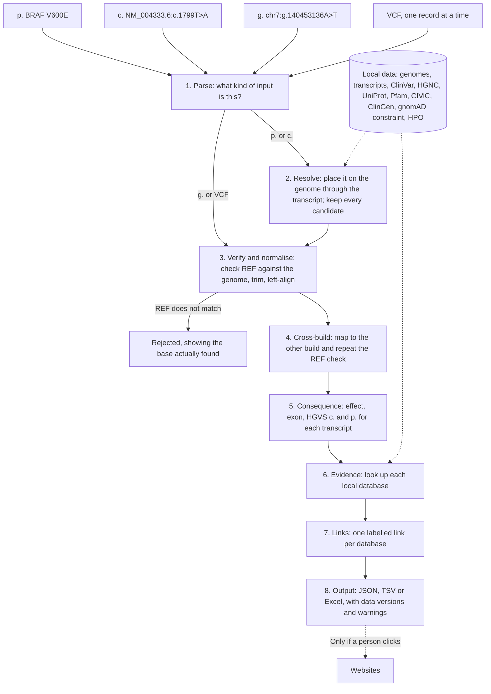

# VarSight

[](https://github.com/YOUR-USERNAME/VarSight/actions/workflows/ci.yml)
[](https://github.com/YOUR-USERNAME/VarSight/actions/workflows/codeql.yml)
[](LICENSE)

**Offline variant annotation for hg19 and hg38.** Give it a protein change, a cDNA change, a genomic position or a whole VCF. It returns the variant on both builds, HGVS names, its effect, what each database says, and a reference link for each database so you can check the result yourself.

```text
$ varsight annotate "BRAF V600E" --build hg19 --format tsv

hg19 chr7-140453136-A-T   hg38 chr7-140753336-A-T   BRAF   NM_004333.6:c.1799T>A   NP_004324.2:p.Val600Glu
missense_variant   ClinVar 13961: Conflicting classifications of pathogenicity   + 20 reference links
```

- **Runs on your computer.** Annotation makes no network connection, so patient variants stay local.
- **Free, with nothing to install but Python.** No API keys, no accounts, no pip packages, no sudo.
- **Quick.** About 3 to 5 ms for one variant and 10 to 15 s for a VCF of about 3,400 records, using about 150 MB of memory ([measured on a 12-gene sample](docs/validation.md#speed-and-memory)).
- **Reports, doesn't judge.** Each source's statement is shown as it stands, with its version. VarSight gives no verdict of its own, and missing data is never treated as benign.

> [!IMPORTANT]
> VarSight is research software. Results for patient care must be checked against the linked sources and validated by your laboratory. See [what has and hasn't been proven](#how-far-it-has-been-tested).

## Quick start

You need Python 3.10 or newer on Linux or WSL. [Step-by-step guide for Windows with WSL](docs/wsl-guide.md).

```bash
git clone https://github.com/YOUR-USERNAME/VarSight.git
cd VarSight
./install.sh
```

That installs the `varsight` command and runs the [demo](demo/README.md), with no download: real data for 12 genes is included in the repository.

To annotate any variant, download and build the full data once. This transfers about 8 GB:

```bash
varsight setup --data-dir ~/varsight-data
```

Then:

```bash
varsight annotate "BRAF V600E" --build hg19
varsight annotate sample.vcf.gz --out results.xlsx
```

## Input

| You have | Example | Build needed? |
|---|---|---|
| Protein change | `BRAF V600E`, `BRAF p.Val600Glu`, `NP_004324.2:p.Val600Glu`, `EGFR E746_A750del`, `BRCA1 E23fs` | Optional; hg38 is used if installed |
| cDNA change | `NM_004333.6:c.1799T>A`, `BRAF c.1799T>A`, `NM_004333.6(BRAF):c.1799T>A (p.Val600Glu)`, `NM_000059.4:c.3901ACT[1]` | Optional |
| Genomic HGVS | `NC_000007.13:g.140453136A>T`, `chr7:g.140453136A>T`, `NC_012920.1:m.3243A>G` | Not with a RefSeq accession; otherwise `--build` |
| Position | `chr7-140453136-A-T`, `7:140453136:A>T`, `chr7:140453136 A>T` | `--build` |
| dbSNP number | `rs113488022`, looked up through ClinVar | Optional |
| A list | A text file with one of the above per line | As above |
| A VCF | `.vcf`, `.vcf.gz` or `.vcf.bgz` | Read from the contig lengths in the header |

One protein change can come from several DNA changes, so a p. input usually returns several ranked candidates. Those known to ClinVar come first, then those changing the fewest bases.

## Output

JSON, JSON Lines, TSV or Excel, chosen by the `--out` extension. This is one result, shortened:

```json
{
  "input": {"raw": "BRAF V600E", "type": "protein", "build": "hg19"},
  "candidate": {"rank": 1, "of": 2, "via": "protein", "in_clinvar": true},
  "variant": {
    "hg19": {"key": "chr7-140453136-A-T", "ref_check": "pass", "hgvs_g": "NC_000007.13:g.140453136A>T"},
    "hg38": {"key": "chr7-140753336-A-T", "ref_check": "pass", "hgvs_g": "NC_000007.14:g.140753336A>T"}
  },
  "gene": {"symbol": "BRAF", "hgnc": "HGNC:1097", "ncbi_gene": "673", "ensembl": "ENSG00000157764", "omim": "164757"},
  "transcript": {"accession": "NM_004333.6", "source": "RefSeq", "mane": "MANE Select", "strand": "-", "protein": "NP_004324.2"},
  "hgvs": {"c": "NM_004333.6:c.1799T>A", "p": "NP_004324.2:p.Val600Glu", "protein_short": "V600E"},
  "effect": {"type": "missense_variant", "exon": 15, "aa_position": 600},
  "protein": {
    "uniprot": "P15056",
    "domains_at_residue": [{"accession": "PF07714", "name": "PK_Tyr_Ser-Thr", "start": 457, "end": 712}]
  },
  "evidence": {
    "clinvar": {"status": "found", "id": 13961, "classification": "Conflicting classifications of pathogenicity", "version": "2026-10-25"},
    "dbsnp": "rs113488022",
    "civic": [{"variant": "V600E", "url": "https://civicdb.org/links/variants/12", "evidence_items": 94}],
    "constraint": {"pli": 0.99995, "loeuf": 0.209, "source": "gnomAD v2.1.1"}
  },
  "links": [
    {"name": "ClinVar", "label": "confirmed_id", "url": "https://www.ncbi.nlm.nih.gov/clinvar/variation/13961/"},
    {"name": "Franklin", "label": "built", "url": "https://franklin.genoox.com/clinical-db/variant/snp/chr7-140453136-A-T"}
  ],
  "versions": {"clinvar.hg19": "2026-10-25", "transcripts.hg19": "2022-03-12"},
  "flags": ["multiple_candidates"]
}
```

For a VCF, your original columns stay in front and annotation columns follow. Every field and every warning flag is described in [docs/input-output.md](docs/input-output.md).

### Reference links

Each result has a link for ClinVar, NCBI Gene, NCBI RefSeq, dbSNP, HGNC, Ensembl, UniProt, Pfam, ProteinPaint, Franklin, COSMIC, VarSome and OncoKB, plus gnomAD, UCSC Genome Browser, ClinGen, CIViC, OMIM, cBioPortal and PubMed.

Each link carries a label, so you know how far to trust it:

- **`confirmed_id`**: the ID came from local data for this variant or gene.
- **`built`**: the address was made from the variant. The page may hold nothing, so it is not evidence on its own.

COSMIC, OncoKB, Franklin, VarSome and ProteinPaint are links only, because their data can't be stored locally for free. [Which links were tested, and how](docs/data-sources.md#reference-links).

## How it works



Every step is one small module, so you can read what it does. See [docs/architecture.md](docs/architecture.md).

## Data sources

Everything is downloaded directly from its original source to your computer. This repository redistributes only a small demo subset.

| Source | Used for | Updated by VarSight |
|---|---|---|
| UCSC hg19 and hg38 | Reference sequence, REF check | Once |
| Ensembl chain files | hg19 to hg38 mapping | Once |
| RefSeq and GENCODE | Transcripts, HGVS names | With your approval |
| MANE | Default transcript | With your approval |
| ClinVar | Classification, conditions, names | Weekly, automatic |
| HGNC | Gene symbols, aliases, IDs | Weekly, automatic |
| UniProt and Pfam | Protein domains and features at the residue | Weekly, automatic |
| CIViC | Cancer evidence | Weekly, automatic |
| ClinGen | Gene-disease validity, dosage sensitivity | Weekly, automatic |
| gnomAD constraint | pLI and LOEUF per gene | Weekly check |
| HPO | Gene-disease links | Weekly, automatic |
| AlphaMissense (optional) | Missense predictions | Add with `--with alphamissense` |
| gnomAD frequencies (optional) | Allele frequencies, hg19 | Add with `--with gnomad` |

Sizes, licences and citations are in [docs/data-sources.md](docs/data-sources.md). **Check the licences against your use**, particularly if results go into paid reports.

## Keeping data current

```bash
varsight data update --check    # what is new; changes nothing
varsight data update            # apply what is safe to apply automatically
varsight data rollback          # go back to the previous data
```

New data is built beside the current data, tested with known variants, and only then switched in. If anything fails, the current data stays. Transcript updates can change c. and p. names, so they wait for `--approve`.

To run it every week automatically, see [docs/updates.md](docs/updates.md).

## How far it has been tested

These results are from real public data for 12 genes (BRAF, KRAS, NRAS, EGFR, TP53, PIK3CA, IDH1, BRCA1, BRCA2, JAK2, KIT, PTEN), using 13,724 ClinVar names per build. [Full results, and every mismatch group](docs/validation.md).

| Test on hg19 | Passed | Rate |
|---|---:|---:|
| Genome position to c. name, SNVs | 9,085 of 9,087 | 99.98% |
| Genome position to c. name, indels | 4,022 of 4,029 | 99.83% |
| Genome position to p. name, SNVs | 6,945 of 6,946 | 99.99% |
| Genome position to p. name, indels | 3,617 of 3,637 | 99.45% |
| c. name back to genome position, SNVs | 9,085 of 9,086 | 99.99% |
| c. name back to genome position, indels | 4,026 of 4,029 | 99.93% |
| p. name back to genome position (position among candidates) | 10,588 of 10,588 | 100% |
| hg19 to hg38 mapping | 13,723 of 13,723 | 100% |

**Not yet proven:**

- **The whole genome.** These rates cover 12 well-studied genes and ClinVar's oldest records. Run `varsight validate` after setup to measure your own full data; [the guide shows how](docs/wsl-guide.md#7-measure-accuracy-on-your-own-data).
- **The full setup.** Every source address and file format has been checked and the whole setup, update and rollback cycle passes against a local test server, but the full 8 GB download has not yet been run end to end. Its time and size figures are estimates.
- **Other Python versions.** Tested on Python 3.14 only so far. CI covers 3.10 to 3.14 once the repository is on GitHub.

Other things to know:

- **Not covered:** CNVs and structural variants, and effects on mitochondrial transcripts (mitochondrial variants still get positions and ClinVar).
- **hg19 transcripts date from March 2022**, the last RefSeq release for GRCh37, so a newer transcript version may be missing. VarSight flags that.
- **No full dbSNP.** An rs number only resolves if ClinVar has it.

## Commands

| Command | What it does |
|---|---|
| `varsight annotate INPUT` | Annotate a description, a list file or a VCF |
| `varsight setup` | Download and build the data |
| `varsight data update` | Apply new source versions |
| `varsight data rollback` | Go back to the previous data |
| `varsight status` | Show what is installed and how old it is |
| `varsight doctor --verify` | Check this computer, and compare data files with their recorded checksums |
| `varsight selftest` | Run the fixed list of known variants |
| `varsight validate` | Measure accuracy against ClinVar's own names |
| `varsight demo` | Run the bundled demo with no download |

## Security and privacy

No runtime dependencies, no telemetry, HTTPS with a host allow-list for downloads, read-only databases, parameterised SQL, spreadsheet-formula protection, and private output files. Automated tests read the source and fail if network code appears outside the download module. [Read the details and your own responsibilities](SECURITY.md).

## Documentation

- [Windows and WSL guide](docs/wsl-guide.md)
- [Input and output reference](docs/input-output.md)
- [Architecture](docs/architecture.md)
- [Data sources, licences and links](docs/data-sources.md)
- [Weekly updates](docs/updates.md)
- [Validation](docs/validation.md)
- [Security](SECURITY.md)
- [Contributing](CONTRIBUTING.md)

## Citing and licence

Code: [MIT](LICENSE). The data belongs to its sources and keeps its own terms. If you publish results, cite VarSight ([CITATION.cff](CITATION.cff)) and the data sources you relied on.
