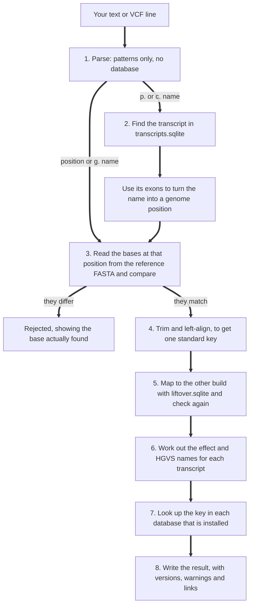

# How a lookup works, and where SQLite comes in

## The short version

SQLite is a database kept in one ordinary file. It needs no server and comes with Python, so there is nothing extra to install.

During `varsight setup`, each large download (ClinVar, RefSeq, HGNC and so on) is converted once into its own SQLite file with an index. When you annotate, nothing is downloaded and nothing is scanned. Each question becomes one indexed lookup in one of those files.

An index works like the index at the back of a book. To find a topic you don't read every page: you look it up and go to that page. ClinVar's VCF is 191 MB compressed. Reading it for every variant would be far too slow, while the indexed lookup measured 27 microseconds on a Linux disk.

## What is on your disk

```text
varsight-data/
  genome/hg19.fa, hg19.fa.fai      the reference bases, plus an index of where each chromosome starts
  genome/hg38.fa, hg38.fa.fai
  db/transcripts.hg19.sqlite       gene structure: exons, coding region, strand
  db/clinvar.hg19.sqlite           ClinVar records and ClinVar's own names
  db/liftover.hg19_hg38.sqlite     how positions map between builds
  db/genes.sqlite                  HGNC names and IDs, ClinGen, gnomAD constraint, HPO
  db/proteins.sqlite               UniProt and Pfam
  db/civic.sqlite                  cancer evidence
  db/dbsnp.hg19.sqlite             only if you added this advanced database
  scores/phylop.hg19.bw            only if you added phyloP; kept as the original file
```

If you chose only one build at setup, only that build's files exist. The files for the other build appear if you later run `varsight setup build=both`.

## Watch it happen

`varsight explain` runs one variant and prints every step, file and query. This is real output from the demo data, with the longer lists shortened:

```text
$ varsight explain "BRAF V600E" build=hg19

Input: BRAF V600E

Step 1. Read the text. No database is needed: patterns decide what kind of input this is.
    Understood as: kind protein, gene BRAF, change p.Val600Glu
    Time: 0.25 ms

Step 2. Place it on the hg19 genome.
    SQLite finds the transcript, then the reference file gives the bases to check against.
    genes.sqlite
      SELECT symbol FROM genes WHERE upper(symbol)='BRAF'
    transcripts.hg19.sqlite
      SELECT * FROM transcripts WHERE gene='BRAF'
    clinvar.hg19.sqlite
      SELECT c.* FROM clinvar_names n JOIN clinvar c ON c.variation_id=n.variation_id
             WHERE n.gene='BRAF' AND n.protein_style='p.Val600Glu'
    Result: 2 candidate(s): chr7-140453136-A-T, chr7-140453135-CA-TT
    The REF base was read from genome/hg19.fa through its .fai index and matched.

Step 3. Annotate the best candidate. Each line below is one indexed lookup, not a scan of the file.
    liftover.hg19_hg38.sqlite
      SELECT * FROM blocks WHERE contig='chr7' AND start<=140453135 AND ... ORDER BY score DESC, start DESC
    clinvar.hg19.sqlite
      SELECT * FROM clinvar WHERE contig='chr7' AND pos=140453136 AND ref='A' AND alt='T'
    genes.sqlite
      SELECT * FROM genes WHERE symbol='BRAF'
    proteins.sqlite
      SELECT * FROM uniprot WHERE gene='BRAF' ORDER BY reviewed DESC LIMIT 1
    civic.sqlite
      SELECT * FROM civic_variants WHERE gene='BRAF' AND upper(variant)='V600E'

Result
    hg19      chr7-140453136-A-T
    hg38      chr7-140753336-A-T
    Names     NM_004333.6:c.1799T>A  NP_004324.2:p.Val600Glu
    Effect    missense_variant
    ClinVar   13961: Conflicting classifications of pathogenicity
    Priority  High: ClinVar oncogenicity: Oncogenic; ClinVar somatic impact: Tier I - Strong; CIViC: 94 evidence items

Nothing left this computer.
```

Run it yourself on any variant. The times it prints are for that one run, and the first run after a reboot is slower because the files aren't in memory yet.

## Step by step



**1. Parse.** Regular expressions decide what the text is: a protein change, a cDNA change, a genomic name, a position, or an rs number. If nothing fits, you get an error listing the forms it understands. No file has been opened yet.

**2. Find the transcript.** For `BRAF V600E` the gene is looked up in `genes.sqlite`, which also resolves aliases such as ERBB1 to EGFR. Then `transcripts.hg19.sqlite` returns the transcripts for that gene, and MANE Select is tried first.

**3. Check against the reference.** This is where a wrong input is caught. VarSight reads the actual bases from the reference file and compares them with what the input claims:

| Input | What is compared |
| - | - |
| `chr7-140453136-A-T` | Is the base at that position really A? |
| `NM_004333.6:c.1799T>A` | After mapping c.1799 through the exons, is that base really T on this strand? |
| `BRAF V600E` | Is residue 600 really Val? The codon is read from the genome and translated. If it isn't, other transcripts of the gene are tried |
| A VCF line | Is REF what the genome has at that position? |

The reference is not in SQLite. It is a plain FASTA file opened as a memory map, and the small `.fai` index says where each chromosome starts. So a read jumps straight to the right place and only that part of the file comes into memory, which is how a 3 GB genome works on a laptop with 4 GB of memory.

**4. Normalise.** The same indel can be written several ways. Trimming and left-aligning gives one standard key, such as `chr7-140453136-A-T`, and that key is what the databases are searched with.

**5. The other build.** The position is mapped with the Ensembl chain data, and the reference check is repeated on that build. If you installed only one build, the result says so with the flag `other_build_not_installed`.

**6. Effect and names.** The c. and p. names are calculated here from the reference sequence and the transcript. This is the only step with real computation in it, and it is why a variant in a gene with many transcripts takes longer.

**7. Evidence.** Each installed database gets one query for that key or gene. A database that isn't installed is skipped, which is why report columns depend on what you chose to install.

**8. Output.** One result, written to the screen or to your reports.

## Why this is safe, and why updates don't disturb it

- Every file opens read-only, in immutable mode with `query_only` on, so annotation can't change the data.
- All values reach SQLite as parameters. A strange gene name can't change a query, and [a test reads the source to enforce it](../tests/test_security.py).
- `varsight update` builds a new file beside the current one, tests it with known variants, and only then swaps it in. Annotation still running keeps the old file it already opened.

## The update notice

Before annotating, VarSight reads one small file, `update_status.json`, in the data folder. That takes no measurable time and uses no network. If the saved answer is over a day old, a separate background process asks each source whether its file changed, and saves the answer for next time. Annotation doesn't wait for it. See [updates.md](updates.md).
