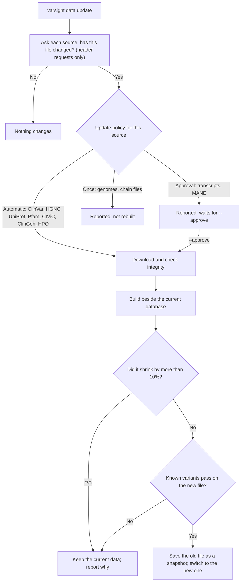

# Weekly updates

## What happens during an update



Any failure leaves what is installed untouched. Each run writes a report to `reports/` in the data folder.

## Commands

```bash
varsight data update --check                       # what is new; changes nothing
varsight data update                               # apply the automatic ones
varsight data update --approve transcripts         # also apply transcript updates
varsight data update --approve transcripts.hg38    # just one
varsight data rollback                             # go back to the previous data
```

The last two snapshots are kept. Each result records the data versions it used, so you can tell which data produced an older result.

## Why transcripts wait for approval

A new transcript release can change c. and p. names for variants you have already reported, so that should be your decision. When you do approve one, run `varsight validate` afterwards.

## Automating it

### Windows with WSL (recommended for a laptop)

Cron inside WSL only runs while WSL is awake, so use Windows Task Scheduler. If the laptop was off at the scheduled time, Windows runs the task at the next chance.

In **Windows PowerShell**, not inside WSL:

```powershell
cd I:\VIP-Annotations\VarSight\scripts\windows
powershell -ExecutionPolicy Bypass -File .\register-weekly-update.ps1 -RepoPath /mnt/i/VIP-Annotations/VarSight -DataDir /home/YOUR-WSL-USER/varsight-data -VarsightCommand /home/YOUR-WSL-USER/.local/bin/varsight
```

This runs every Sunday at 09:00. Change it with `-Day Monday -Time 20:00`. It needs no administrator rights.

```powershell
Start-ScheduledTask -TaskName 'VarSight weekly data update'      # try it now
powershell -ExecutionPolicy Bypass -File .\register-weekly-update.ps1 -Unregister    # remove it
```

Use `-Distribution Ubuntu` if you have more than one WSL distribution.

### Linux

```bash
crontab -e
```

Add this line, with your own paths:

```text
0 9 * * 0  /path/to/VarSight/scripts/weekly-update.sh /home/me/varsight-data /home/me/.local/bin/varsight
```

## After an update

```bash
ls ~/varsight-data/reports/      # one log and one JSON report per run
varsight status                  # versions now in use
```

The script exits with a non-zero status when something failed, so your scheduler can show it.

## Sources changing their layout

Sources move files and rename columns without notice. Three things catch this:

- `tools/check_sources.py` asks every source whether its file is still there. A scheduled GitHub workflow runs it weekly.
- Builders check for the columns they need, and fail with a clear message rather than building an empty table.
- A broken source fails only its own database. Everything else carries on, and the current data stays in place.
