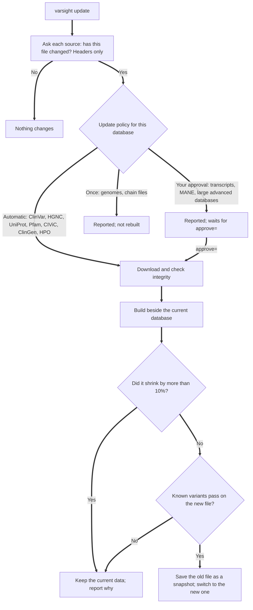

# Keeping the databases current

## How you find out

You don't need to remember. Before each annotation VarSight reads one small saved file, and if a newer version exists it prints a notice and then carries on:

```text
Update available: ClinVar, HGNC. These results use your installed versions.
  To update: varsight update    To hide this: varsight config updates=off
```

The same notice appears at the top of the HTML report and on the Summary sheet in Excel, so a reader can see which versions the results used.

It doesn't slow anything down:

| Step | What happens | Waits for the network? |
| - | - | - |
| Read the notice | Reads `update_status.json` from the data folder | No |
| Annotate | As usual, using what is installed | No |
| Check for news, at most once a day | A separate background process asks each source, using header requests only, and saves the answer for next time | No: annotation doesn't wait for it |

The check sends only an ordinary request for each public file. Nothing about your variants or files goes with it, and a test reads the source to check this. To turn it off:

```bash
varsight config updates=off
```

If no check has been possible and your data is over 30 days old, the notice says that instead.

## What happens during an update



Any failure leaves what is installed untouched. Each run writes a report to `reports/` in the data folder.

## Commands

```bash
varsight update check                  # what is new; changes nothing
varsight update                        # apply the automatic ones
varsight update approve=transcripts    # also apply transcript updates
varsight update approve=dbsnp          # one advanced database
varsight rollback                      # go back to the previous data
```

The last two snapshots are kept. Each result records the data versions it used, so you can tell which data produced an older result.

## Which updates apply on their own

| Policy | Databases | Why |
| - | - | - |
| Automatic | ClinVar, HGNC, UniProt, Pfam, CIViC, ClinGen, HPO, Cancer Hotspots, DECIPHER, ClinGen classifications | Small and frequent, and don't change how variants are named |
| Your approval | RefSeq, GENCODE, MANE, dbSNP, gnomAD, 1000 Genomes, REVEL, AlphaMissense, phyloP | Transcript releases can change c. and p. names you have already reported, and the others are very large downloads |
| Once | Reference genomes, chain files | Not expected to change |
| Your own file | COSMIC, Census, fusions, OMIM, SpliceAI, PrimateAI | They need your account, so VarSight can't fetch them. To update one, download the new release and run `varsight add` again |

When you approve a transcript update, run `varsight validate` afterwards.

## Making it automatic

### Windows, native install or WSL

Cron inside WSL only runs while WSL is awake, so use Windows Task Scheduler. If the laptop was off at the scheduled time, Windows runs the task at the next chance. In **PowerShell**, from the `scripts\windows` folder of the repository:

For a native Windows install:

```powershell
powershell -ExecutionPolicy Bypass -File .\register-weekly-update.ps1 -DataDir C:\Users\YOU\varsight-data
```

For a WSL install:

```powershell
powershell -ExecutionPolicy Bypass -File .\register-weekly-update.ps1 -DataDir /home/YOU/varsight-data -WslCommand /home/YOU/.local/bin/varsight
```

This runs every Sunday at 09:00. Change it with `-Day Monday -Time 20:00`, and use `-Distribution Ubuntu` if you have more than one WSL distribution. It needs no administrator rights.

```powershell
Start-ScheduledTask -TaskName 'VarSight weekly data update'
powershell -ExecutionPolicy Bypass -File .\register-weekly-update.ps1 -Unregister
```

The first line tries it now, and the second removes it.

### Linux

```bash
crontab -e
```

Add this line, with your own paths:

```text
0 9 * * 0  /path/to/VarSight/scripts/weekly-update.sh /home/me/varsight-data /home/me/.local/bin/varsight
```

The script exits with a non-zero status when something failed, so your scheduler can show it. It writes a dated log to `reports/` in the data folder.

## Sources changing their layout

Sources move files and rename columns without notice. Three things catch this:

- `tools/check_sources.py` asks every source whether its file is still there. A scheduled GitHub workflow runs it weekly.
- Builders check for the columns they need, and fail with a clear message rather than building an empty table.
- A broken source fails only its own database. Everything else carries on, and the current data stays in place.
